


  
  
  
  

 

  

 

> I'm a B.Tech Computer Science student and backend developer who builds production-style Java applications — from a full-stack AI transcription platform to console apps with real database layers (**JDBC, MySQL, PostgreSQL, MongoDB**). Currently deepening my skills in **Spring Boot, system design**, and applying **AI to backend workflows**.

 

<b>LANGUAGES &amp; FRAMEWORKS</b> 

<b>DATABASES</b> 

<b>TOOLS &amp; DEVOPS</b> 

<b>AI / ML ENGINEERING</b> 
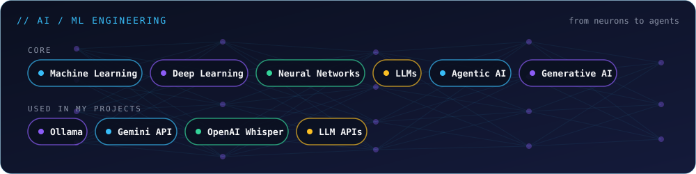

<b>CORE CS FUNDAMENTALS</b> 

 


  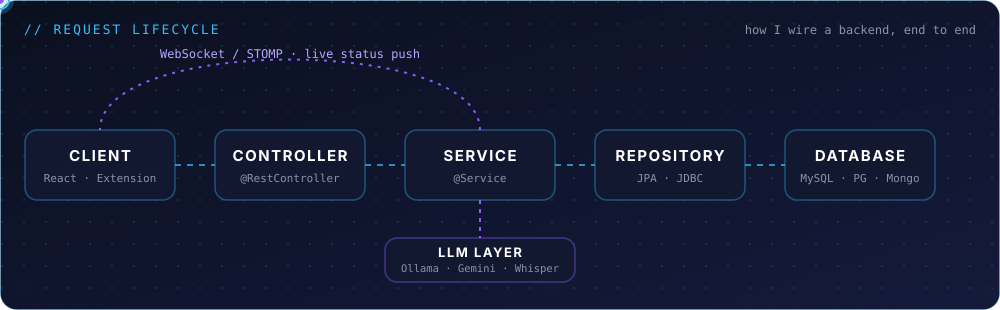

 

<a href="https://github.com/PiyushSaxena05/TSCRIPT-AI-"></a>
<a href="https://github.com/PiyushSaxena05/Nexquira"></a>
<a href="https://github.com/PiyushSaxena05/Orvixa"></a>
<a href="https://github.com/PiyushSaxena05/SOLARIQ"></a>
<a href="https://github.com/PiyushSaxena05/Healthdoc"></a>
<a href="https://github.com/PiyushSaxena05/TaxiBookingSystem"></a>
<a href="https://github.com/PiyushSaxena05/Recyclatics"></a>
<a href="https://github.com/PiyushSaxena05/Task-Management-System-Spring-MVC-Project-"></a>

<b>More projects</b>

 

- ⛽ **[Fuel Station](https://github.com/PiyushSaxena05/Fuel-Station)** — Simulates a real-world fuel station with dynamic payment flows and travel range estimation.
- 🍽️ **[AntiFoodWastageSystem](https://github.com/PiyushSaxena05/AntiFoodWastageSystem)** — Java Servlet + HTML project to reduce food wastage in hostels/offices by notifying about surplus meals.
- 🔥 **[HabitStreakTracker](https://github.com/PiyushSaxena05/HabitStreakTracker)** — Console app tracking daily habit streaks with JDBC + MySQL.
- 🏨 **[Hotel Reservation System](https://github.com/PiyushSaxena05/Hotel-Reservation-System)** — Hotel reservation management system built with Java and JDBC.

 

  

 


  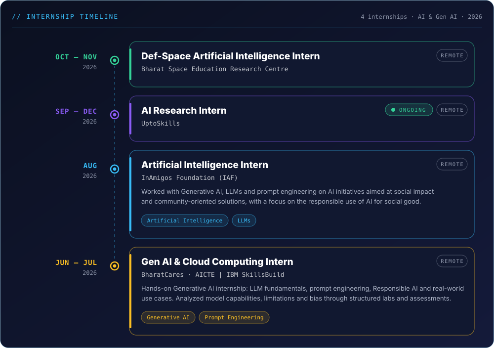

 


<picture>
  <source media="(prefers-color-scheme: dark)" srcset="https://raw.githubusercontent.com/PiyushSaxena05/PiyushSaxena05/output/github-snake-dark.svg"/>
  <source media="(prefers-color-scheme: light)" srcset="https://raw.githubusercontent.com/PiyushSaxena05/PiyushSaxena05/output/github-snake.svg"/>
  
</picture>

 


 

**📧 [piyushsaxena168@gmail.com](mailto:piyushsaxena168@gmail.com)**  ·  **💼 [LinkedIn](https://www.linkedin.com/in/piyush-saxena-160036347)**  ·  **🐙 [GitHub](https://github.com/PiyushSaxena05)**

